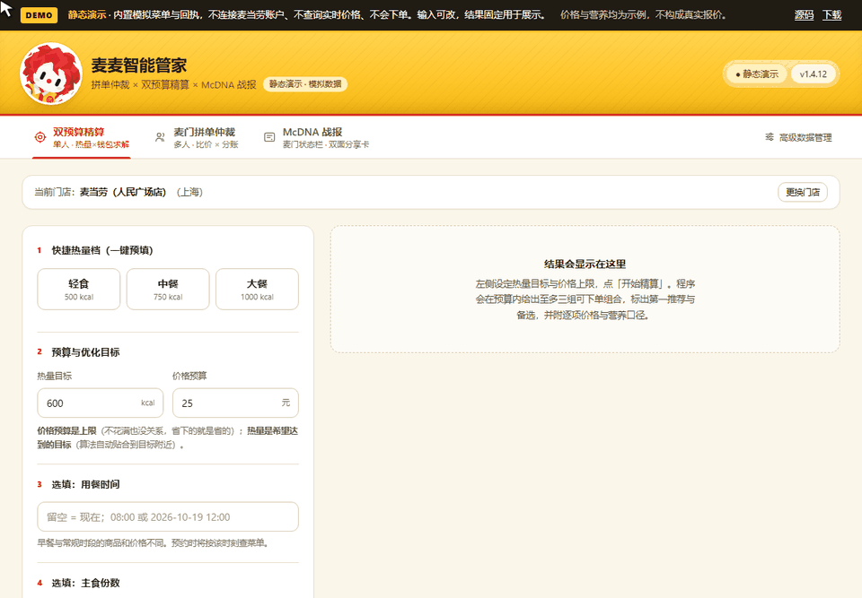
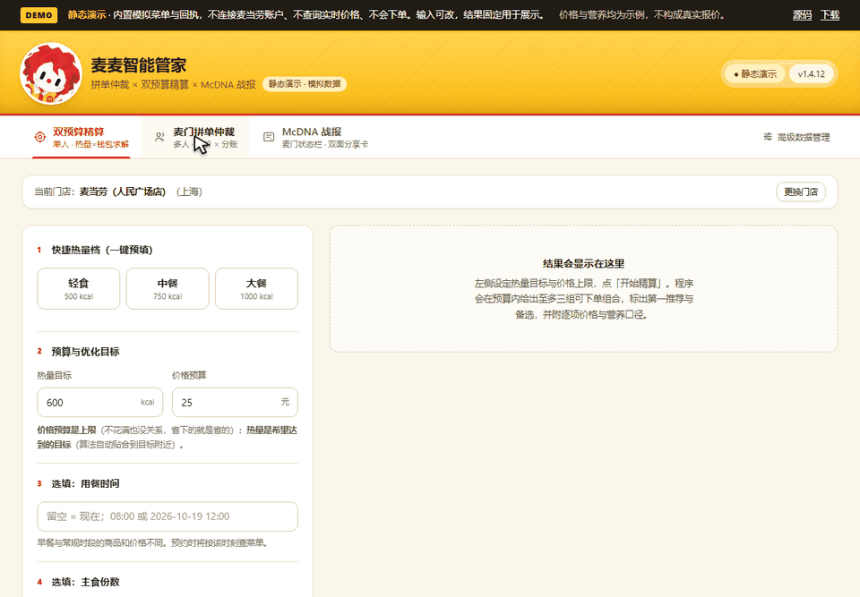
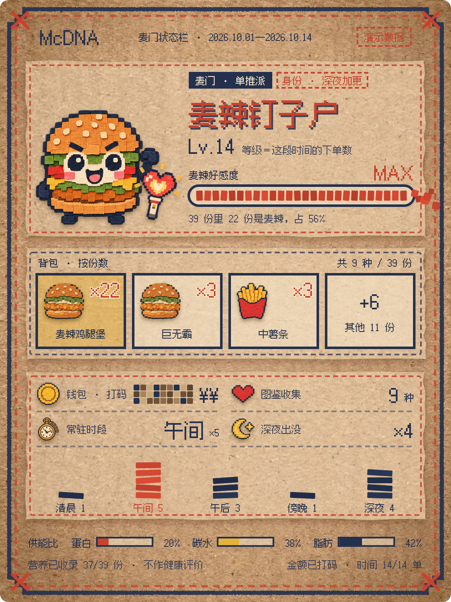
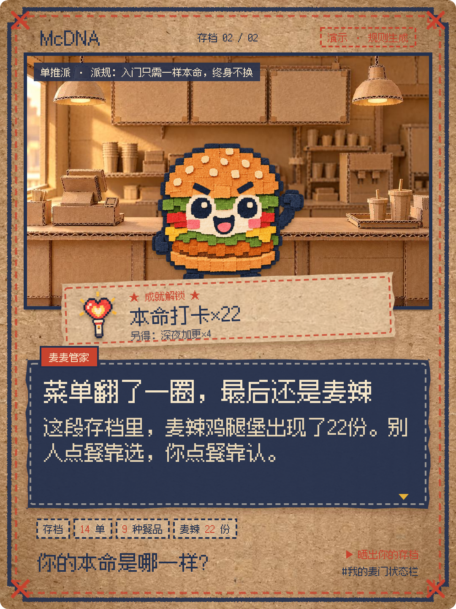
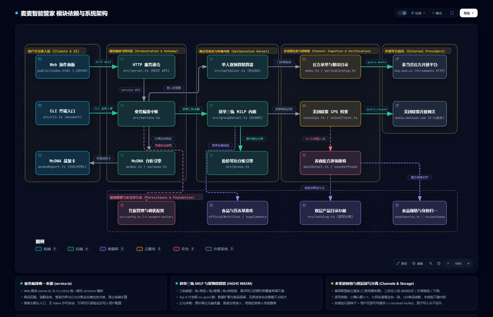

# 麦麦智能管家 · McSmart Butler

**「今天吃什么？」把预算、热量和每个人的心愿，一起算进去。**

面向日常在麦当劳点餐的个人，以及办公室、宿舍、朋友聚餐的拼单发起人：一个人按预算配一餐，一群人按各自心愿拼一单，常客还可以把消费记录做成 McDNA 分享卡。日常操作使用本机网页面板，已有 WorkBuddy 等 Agent 的用户也可通过 Skill 使用。

  <a href="https://hanmoy.github.io/mcsmart-butler/demo/"><strong>▶ 在线试玩静态 Demo</strong></a>
  &nbsp;·&nbsp;
  <a href="https://github.com/Hanmoy/mcsmart-butler/releases">下载 Release</a>
  &nbsp;·&nbsp;
  <a href="#30-秒跑起来">本机启动</a>

> 麦当劳程序员创意开发大赛参赛项目，非麦当劳官方产品。真实点餐使用你自己的麦当劳 MCP Token；本工具只提供决策与购买清单，不代下单、不代付、不托管券码。

## 目标用户与使用场景

**核心用户是普通麦当劳消费者：一个人点餐时需要兼顾预算与营养的人，以及负责收集需求、统一点餐和分账的多人拼单发起人。** 先找到自己的处境，再看对应示例：

| 你是谁 | 什么时候会用 | 你提供什么 | 管家交付什么 |
| --- | --- | --- | --- |
| 独自点午餐的上班族、学生，关心预算和营养 | 午休想吃麦当劳，既不想超预算，又想兼顾热量或蛋白质 | 门店、价格上限、热量目标、营养偏好 | 完整购买组合、实际选配、价格与营养说明；见[单人午餐示例](#example-single) |
| 办公室、宿舍、朋友局的拼单发起人 | 大家各有想吃的，有人要无糖、有人限热量，最后还要分账 | 群聊或逐人的心愿、份数、忌口与限制 | 怎么买、怎么分给每个人、各付多少、哪些需求没满足；见[三人拼单示例](#example-group) |
| 想比较官方套餐和团购券的点餐用户 | 看见便宜券，或手里已有券，想确认能否凑齐这一餐 | 同一份点餐需求，以及已购券的实付价、食品、规格和份数 | 可参与比较的用券与不用券方案、购买途径及价格依据；见[用券示例](#example-voucher) |
| 常吃麦当劳、喜欢记录和分享的消费者 | 想知道最近常吃什么、偏爱哪个时段，发一张有个人特点的图 | 本人选择读取的订单记录；也可先看演示样本 | 按记录生成的 McDNA 双面分享卡，金额默认档位脱敏；见[分享卡示例](#example-mcdna) |

普通点餐用户可以直接操作面板；真实配餐需先完成[本机启动与本人 Token 配置](#30-秒跑起来)。[在线 Demo](https://hanmoy.github.io/mcsmart-butler/demo/)提供免配置的预设场景体验。

## 和「问 AI」「看官方 App」「找团购券」「普通比价」的不同

| 问题 | 常见做法 | 麦麦智能管家 |
| --- | --- | --- |
| 「700 kcal、32 元，帮我点一餐」 | 聊天给菜名；价格和营养靠印象 | 把整篮热量、价格上限、营养优先级写进确定性模型；输出完整购物篮、每份选配与营养来源 |
| 「三个人，各有想吃的，还要 AA」 | 各自在官方 App 点，群里手算 | 一次建模多人份数、忌口、热量上限和套餐完整购买单元；输出逐人分配、缺口与分账 |
| 「团购便宜，但跟套餐怎么搭？」 | 比价工具通常只比单品或券面价 | 同时比较单点、套餐与合法换选、已核验团购券；购买途径并列展示，不拿券价直接冒充整单价 |
| 「别给我编，缺什么就说」 | 结果看起来都满足，实际靠猜 | 营养缺失不当 0；没满足的心愿进入缺口；价格来源与证据等级逐条标注 |

**不是官方 App 的替代品。** 下单、支付、核销仍然在麦当劳官方渠道完成；管家做的是官方交易入口之前的决策层：买什么、怎么配、分给谁、每个人付多少。

**也不是「换个聊天框点菜」。** Agent 可以负责理解那句「随便，别太贵」，但食品匹配、套餐轮次、营养约束、价格排序和分账由同一套业务服务与 MILP 内核完成。换一个对话，不会换一套算账口径。

## 使用示例：从你的处境开始

### 场景 1｜单人午餐：兼顾预算与营养

**适用用户：** 一个人点餐的上班族或学生。午休时间有限，想在 ¥32 内吃一餐，热量尽量接近 700 kcal，并优先考虑蛋白质。

这句话对应的输入是：

~~~text
热量目标 700 kcal，价格上限 32 元，优先蛋白质更多。
~~~

**怎么用：** 在本地面板选择门店，填写热量目标和价格上限，勾选「蛋白质↑」，点击「开始精算」。

**得到什么：** 一份能逐项核对的购买清单和备选方案。下面的模拟菜单示例推荐 **板烧鸡腿堡三件套：691 kcal／¥32**，展开可看每份选配与营养来源。同套餐的不同选配收进一张卡，分别列价和营养。

  

这里的热量是「尽量贴近」的目标，不是偷偷当成硬上限；预算才是整单硬上限。结果卡会同时说明整篮营养、本人分配和剩余，避免把「买了多少」与「吃进去多少」混成一件事。

### 场景 2｜三人拼单：替发起人收需求和分账

**适用用户：** 办公室、宿舍或朋友局里负责统一点餐的人。三个人发来五个心愿，还有无糖和热量要求，发起人需要把它们整理成同一单：

~~~text
小林：板烧鸡腿堡、零度可乐
小周：麦辣鸡腿堡、薯条
小陈：麦香鱼，控卡 400
~~~

**怎么用：** 在本地面板「多人拼单」粘贴群聊，核对解析后的成员确认卡，再开始仲裁。

**得到什么：** 整单购买清单、每个人分到的食品、分账与未满足需求。下面的模拟示例满足三个人的心愿，整单 **¥75**；发起人可切换分账视图，并复制购买清单。

  

多人不是「把三个单人套餐加在一起」。模型要同时决定买哪些套餐、每个套餐槽位怎么换、每件分给谁；套餐必须按完整购买单元成立，不能把 A 套餐的槽位和 B 套餐拼成一个假套餐。心愿没接住会如实进入缺口，不会悄悄消失。

### 场景 3｜手里有券：比较怎样凑齐同一餐

**适用用户：** 自己点餐或替大家拼单、手里已有团购兑换券的人。真正要解决的是“这张券加上必要补点，能否满足这次需求，总共要花多少”。

**怎么用：** 在本地面板「多人拼单 → 我的券」录入已购券的名称、实付价和券面食品，保留规格与份数，再填写或确认成员心愿。准备买新券时，也可查看查询到的团购及其内容核验状态。

**得到什么：** 在内容可核验、食品可映射时，比较单点、套餐及用券组合，列明整单价格、缺口和购买途径。内容不明的券保留为价格候选，适用门店与核销条件由用户在券面确认。

### 场景 4｜常客分享：把消费记录做成 McDNA

**适用用户：** 常吃麦当劳，想在朋友圈或小红书分享自己点餐习惯的人。

**怎么用：** 打开「McDNA 战报」，先用演示样本看效果；需要自己的卡片时，主动选择读取本人真实订单，保留默认的金额档位脱敏，再生成并下载。

**得到什么：** 一张展示本命食品、常点背包和饭点的正面卡，以及一张带门派、成就和评语的背面卡。见下方[McDNA 双面样卡](#mcdna-card-samples)。统计来自接口实际返回的记录，少订单或零订单保留真实状态。

> **演示说明：** 上面两支 GIF 使用模拟菜单与示例回执，展示操作流程；其中的金额和营养不是真实报价。在线 Demo 提供锁定条件的预设场景，单人可切换午餐、双主食和预算不足，三人拼单使用固定示例。自由输入与个人数据功能请使用本地完整版；下单价格以官方结算页为准。

## 怎么算

不是把菜单丢给大模型让它即兴发挥，而是把「买哪些食品／套餐／券、每份怎么选配、分给谁」建成一个混合整数线性规划（MILP）：

- **整篮建模。** 预算、热量目标、营养上下界、主食份数、成员热量上限、忌口与无糖要求一起进入约束；先可行，再按固定优先级逐段求最优。
- **套餐是完整购买单元。** 保留官方套餐轮次、默认项、合法换选与补差；不把默认搭配当成唯一搭配，也不跨套餐拼槽。
- **三条购买轨道。** 官方单点；官方套餐与合法换选；内容已核验、能映射到官方食品的团购券／用户券。同食品不同购买途径并列，内容相同才归并。
- **Top-K 按食品内容去重。** 换玩具、换排列不占推荐名额；数量变化仍是不同的购物篮。
- **把「不确定」留在结果里。** 营养缺失不按 0 算，估算值带标记；价格区分官方计价、菜单价、模型价与快照参考价；未满足心愿有结构化缺口。

完整的 MCP Server／Tool 调用链、字段口径和模型优先级见 [MCP_INTEGRATION.md](MCP_INTEGRATION.md)。

## 单人：预算等约束内算明白

- **价格预算是整单上限；热量输入是整篮购买热量的贴合目标。** 严格营养上下界与目标值是两种要求；CLI／业务接口支持通过 `constraints` 显式设置热量等硬约束。
- 保留实际食品、规格、数量、套餐轮次与换选补差；不把含糖和无糖、大份和中份合并成同一食品。
- 单人购物篮允许有剩余：结果分别展示整篮营养、本人分配与逐项剩余；营养硬约束按本人分配判定，费用仍按整篮计算。
- 没有可行方案时说明原因，不用零元方案或营养未知值冒充满足需求。

## 多人：先说明怎么买，再说明怎么分

粘贴群聊，或直接填写成员确认卡。最多 8 人，逐人编辑心愿、忌口、热量上限、无糖需求、个人优惠与备注；文本解析后仍需核对确认卡。

结果会回答四件事：

1. **买什么**：官方单点、套餐与合法换选，或已核验的团购／用户券；
2. **怎么配**：每份套餐的槽位与换选，不把默认项当作固定项；
3. **拿什么**：逐人分配、未满足心愿与缺口原因；
4. **付多少**：按分得食品的参考原价比例分摊；缺原价时按单位数，再退到人数等额，尾差只做舍入校正。

分账、购买清单和复制文本共用同一份结构化结果，避免「页面看起来全满足、复制出来少一项」。只输出购买指引与分账，不代下单、不代付、不托管券码或他人账户权益；「少冰、去配料」等备注仍需在实际下单时确认。

## McDNA：本命食物长成你的麦门状态栏

纸板像素风，正反两张 **1080×1440** 分享卡：

- **正面**：订单等级、本命食品、食品背包、钱包档位与常驻饭点；
- **背面**：麦门门派、生活场景、成就、管家评语和可接话的分享提问；
- **8 个门派**：单推派、夜巡派、早课派、图鉴派、甜区派、随心派、准点派、见习派，按订单统计与明确门槛判定；
- 主角依据常点食品在 8 类身体、3 种姿势中选择，再搭配门派道具和 4 个场景。

  
  

**默认不需要额外的文本模型 API。** 程序用内置梗库生成文案；想更有个人味道，可以在面板复制事实提示词，交给自己的 Agent，直接让它在模板基础上生成或者把 JSON 粘贴回来。Agent 只填写称号、判词、成就、对话和结尾提问；数字通过事实编号由程序代入，程序检查事实引用、食品、糖型／规格、长度和内容边界，不合格文案不会覆盖已有成品。

正反面可分别下载 SVG 与 PNG。金额默认档位脱敏；选择完整金额后，导出的卡片也会包含该金额。真实订单按接口实际返回的区间统计，少订单与零订单保留真实状态，失败时不自动改用演示。这是娱乐化消费记录，不是人格测评或健康评价。

## 在线试玩

**▶ [打开静态 Demo](https://hanmoy.github.io/mcsmart-butler/demo/)**（GitHub Pages，只读）

- 复用真实面板的 HTML、交互与渲染路径；只在网络边界注入模拟回执。
- 不连接麦当劳账户，不读取 Token，不查询实时价格，不创建订单。
- 提供午餐、双主食、预算不足三个完整示例；切换场景时同步条件与结果，示例条件锁定，不支持自由输入计算。页面和结果卡都标注了「静态演示」。
- 同套餐的不同选配收进一张推荐卡，分别保留真实配置、价格与营养；多人页使用锁定的三人示例。任意热量/预算/心愿计算请运行本地完整版。
- McDNA 页使用内置演示订单，不需要真实账户。

如果 Pages 链接暂时不可用，在本机按下一节启动面板即可；本地面板只监听 `127.0.0.1`，不会把带账户能力的服务暴露到公网。

## 30 秒跑起来

需要 Node.js 与 npm。项目声明 Node.js ≥20；建议使用 Node.js 24.x。Python 只用于可选的浏览器回归，不是日常运行依赖。

下面以 Windows PowerShell 为例：

~~~powershell
git clone https://github.com/Hanmoy/mcsmart-butler.git
if ($LASTEXITCODE -ne 0) { throw "克隆失败，请先确认仓库已公开且地址正确" }
Set-Location -LiteralPath mcsmart-butler -ErrorAction Stop
npm.cmd ci
if ($LASTEXITCODE -ne 0) { throw "依赖安装失败" }
npm.cmd run build
if ($LASTEXITCODE -ne 0) { throw "编译失败，未启动面板" }
node dist/cli.js ui --open
~~~

1. 首次打开时，从页面进入 [麦当劳 MCP 开放平台](https://open.mcd.cn/mcp)，由本人申请个人 Token。
2. 粘贴到面板的遮蔽输入框，点击「验证并保存」；验证只调用官方时间接口。
3. 选择城市和门店，开始单人精算或多人拼单。

**无需把 Token 发到聊天、Issue 或仓库。** 没有 Token 也能先浏览面板，在 McDNA 页面使用内置演示样本；实时配餐和真实订单仍需本人接入。开发者也可使用 `MCD_MCP_TOKEN` 环境变量；读取顺序为非空环境变量优先、用户本地配置其次。

<strong>在 WorkBuddy / Agent 宿主中使用（展开）</strong>

根目录 `SKILL.md` 是开发仓库说明，不能只复制该文件完成安装。正式 Skill 从源码打包生成：

~~~powershell
node scripts/package-skill.mjs build --zip
if ($LASTEXITCODE -ne 0) { throw "打包失败" }
~~~

输出 `dist-package/mcsmart-butler/` 与对应版本 ZIP。先确认宿主实际加载的技能目录，例如 `.workbuddy-ai/skills`：

~~~powershell
$skillDir = Join-Path $env:USERPROFILE ".workbuddy-ai/skills/mcsmart-butler"
node scripts/package-skill.mjs install --from dist-package/mcsmart-butler --to "$skillDir"
node "$skillDir/scripts/mcsmart.mjs" doctor
node "$skillDir/scripts/mcsmart.mjs" ui --open
~~~

国内版等其他安装环境可能使用 `.workbuddy/skills`，请按实际目录选择。重新加载技能后，可以这样描述需求：

~~~text
一个人，预算 25 元，热量目标 600 kcal，优先少钠，帮我选门店后配一餐。

三个人拼单：小林要麦辣鸡腿堡和无糖可乐，小周要薯条，
小陈想吃麦香鱼。先让我确认成员需求，再比较怎么买、怎么分账。

先用演示订单看看 McDNA。之后我明确选择真实订单时，再读取我的账户。
~~~

智能体统一调用确定性 CLI，不自行重新计算购物篮、营养或分账。详见 [正式 Skill 模板](skill-template/SKILL.md)。

## 数据和价格怎么看

| 数据 | 当前处理方式 |
| --- | --- |
| 门店菜单与套餐轮次 | 麦当劳官方 MCP；目标时间查询传递同一时间上下文 |
| 营养 | 按食品和规格联结 MCP 营养表、本地官网营养资料与已有调查补录；估算和未知字段保留标记 |
| 官方部分价格 | 标注官方计价、菜单价或模型价；单人方案不承诺整篮已逐一官方核价 |
| 美团团购 | 内置联盟客户端按城市查询；内容已核验且可映射的条目参与自动组合，其余保留为价格候选 |
| 历史菜单与团单 | 标记快照日期与参考价，受时效限制，不冒充实时结果 |

美团联盟凭据读取优先级为：**环境变量 → 用户配置 → 随包内置凭据**。当前项目保留随包内置来源；可用自己的 `MEITUAN_UNION_APPKEY`、`MEITUAN_UNION_APPSECRET` 覆盖。联盟接入独立于麦当劳 MCP，项目不生成推广归因短链。

团购查询保留所选城市与官方门店菜单上下文，**不校验券的具体适用门店**，不据此宣称全国通用。购买与核销前请在券面和官方下单页确认适用条件。

## 当前边界（请先读）

- 目前以到店自取为主（`orderType=1`、`beType=1`）；查询目标时间菜单不代表已提交预约订单。
- 求解受本次菜单、候选池、搜索预算和核验能力限制，不承诺全平台绝对最低价；发现层及求解池设有上限，截断会给出说明。
- 营养缺失不视为零；估算可用于普通目标参考，不能据此宣称严格达标或作专业健康建议。
- 官方菜单与快照均不可用时，保留需求和渠道查询信息，不生成推荐购物篮；完整离线配餐尚未实现。
- McDNA 真实订单入口已实现，但**非空真实账户订单与金额字段适配尚未完成联网验收**；演示图与模拟测试不作为该项验收证明。
- 历史验证记录保留在本地，不随公开仓库分发；README 中的截图、GIF 与测试结果仅代表对应时间和范围。

## 安全与第三方凭据

- 面板只监听 `127.0.0.1`；麦当劳个人 Token 只保存在本机用户目录，不写入仓库、日志或分享卡。
- 团购查询使用随包 `data/union-credentials.json` 中的第三方联盟凭据（来源与替换方式见 [SECURITY.md](SECURITY.md)）。它不是麦当劳官方凭据，也不代表美团官方授权；可用环境变量或用户配置替换为自己的凭据。
- 仓库不包含个人订单、账号配置或手机号。提交 Issue/PR 时请勿粘贴 Token、券码或订单截图。
- 静态 Demo 的 `docs/demo/` 只含模拟回执与公开素材，不包含凭据、账户或订单数据。
- 安全问题请按 [SECURITY.md](SECURITY.md) 的私密渠道报告。

## 开发与验证

技术栈：Node.js、TypeScript、HiGHS WASM／MILP、原生 HTML/CSS/JavaScript。业务编排唯一入口为 `src/service.ts`，HTTP 与 CLI 共用它。

  

> 💡 **架构交互版**：可直接在浏览器打开 [`docs/architecture.html`](docs/architecture.html) 进行缩放平移、节点拓扑高亮与深浅色模式切换。

~~~powershell
npm.cmd run build
npm.cmd test
npm.cmd run test:browser
node scripts/report-delivery-drift.mjs --install "$skillDir"
~~~

浏览器回归使用 **Python Playwright 与 Chromium**；未找到可用解释器时明确跳过，不等于通过。可用环境变量 `PYTHON` 指定解释器。

CI 在 Windows 上使用 Node.js 22／24 执行依赖安装、构建、Node 测试、浏览器回归和打包烟测；设置 `MCSMART_REQUIRE_BROWSER=1` 时，找不到 Playwright 会直接失败而不是跳过。

欢迎通过 Issue 反馈问题和提交 PR；提交前请阅读 [CONTRIBUTING.md](CONTRIBUTING.md)，不要附带 Token、券码、订单或本机配置。

~~~text
src/service.ts              业务编排与输出契约
src/optimizer.ts            单人／多人共享 MILP 模型
src/groupKernel.ts          多渠道建池、方案比较与分账
src/menu.ts                 官方菜单、规格与套餐轮次
src/unionCps.ts             联盟团购查询与核验
src/mcdna*.ts               订单统计、门派与事实文案
src/cli.ts / src/server.ts  CLI 与本机 HTTP 入口
public/                     面板、战报渲染器与素材
scripts/demo-fixtures.mjs   用真实 service + 离线菜单生成演示回执
scripts/build-static-demo.mjs 从真实面板生成 docs/demo
skill-template/             正式 Skill、启动器与参考文档
~~~

版本以 `package.json` 为准，当前为 **1.4.12**；发布记录见 [CHANGELOG.md](CHANGELOG.md)。同一版本号下源码仍可能有后续页面修订，发布包应重新由当前源码生成，并用漂移检查核对内容。

## 许可与致谢

项目原创代码采用 [MIT License](LICENSE)。麦当劳名称、标识及来源数据的相关权利归原权利人；第三方组件和字体遵循各自许可，见 [THIRD_PARTY_LICENSES.md](THIRD_PARTY_LICENSES.md)。

- [麦当劳官方 MCP 接入指南](https://github.com/M-China/mcd-mcp-server)
- [麦当劳程序员创意开发大赛](https://github.com/M-China/mcd-developer-innovation-challenge)
- [参赛声明](CONTEST_DECLARATION.md)
- [WorkBuddy 开发上下文](workbuddy.md)
