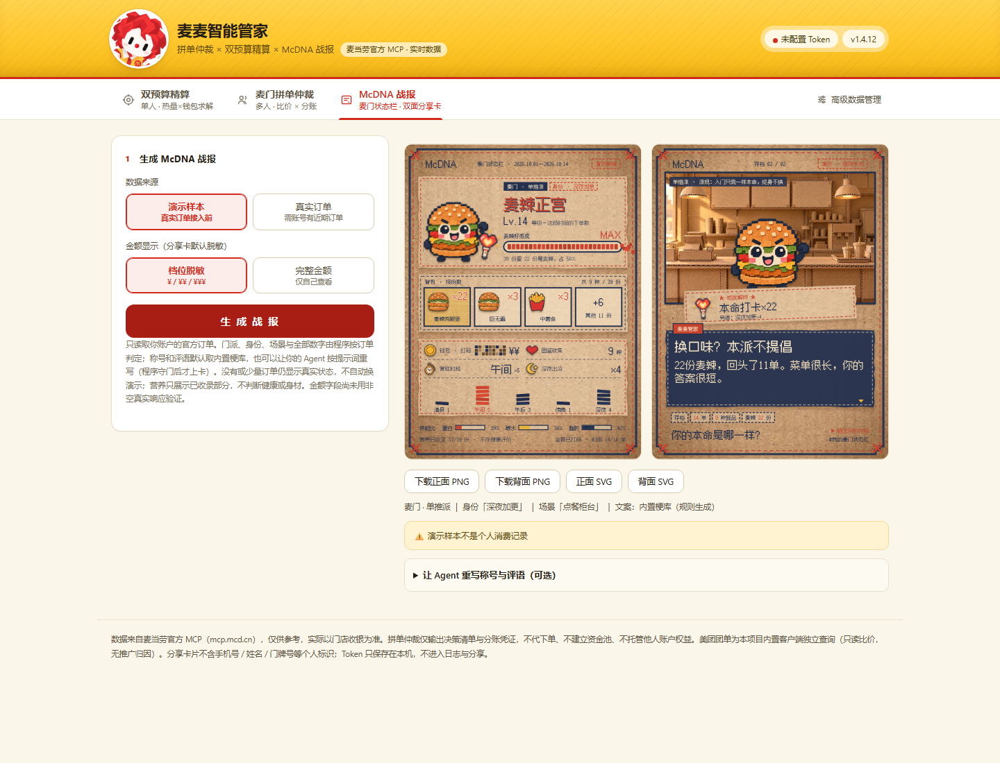
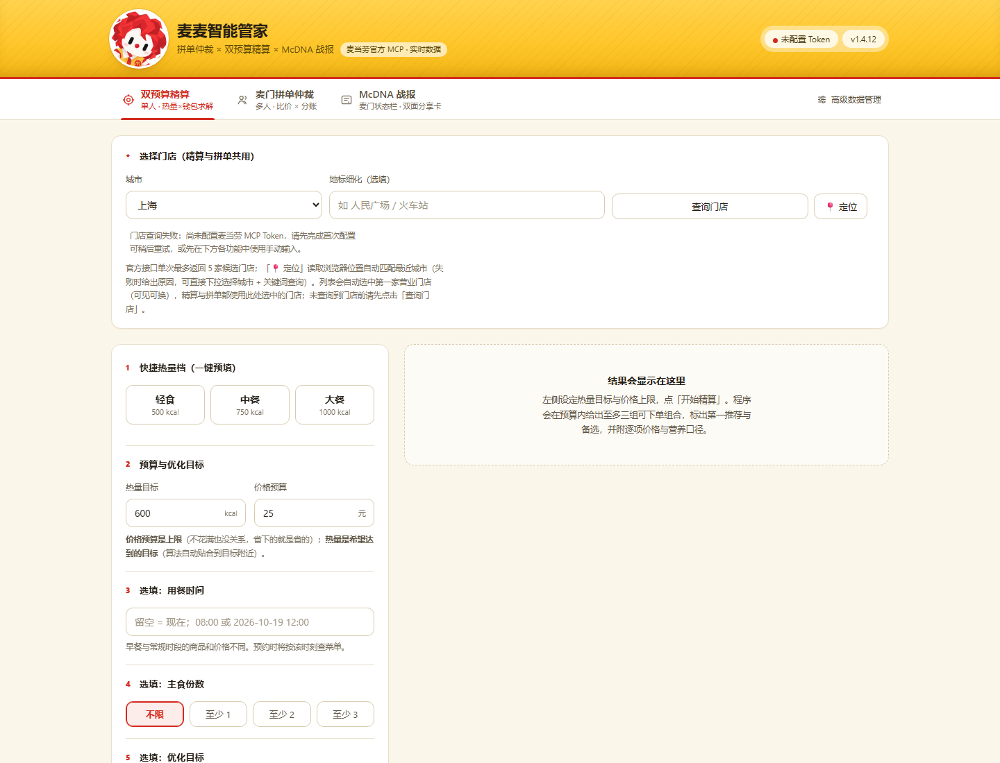
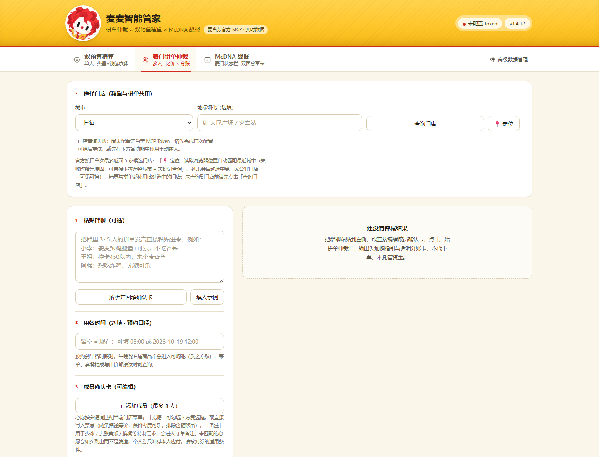

# 麦麦智能管家 · McSmart Butler

**把想吃什么、预算和营养目标，变成一张能照着点、能分清账的麦当劳购物清单。**

基于麦当劳官方 MCP 的本机面板与 Agent Skill：一个人搭配一餐，一群人比较套餐与团购，再把近期订单变成有自己本命食物的 McDNA 分享卡。

  

> 麦当劳程序员创意开发大赛参赛项目，非麦当劳官方产品。图中为明确标注的演示数据；真实点餐使用自己的麦当劳 MCP Token，程序只提供决策与清单，不代下单。

## 三件日常小事，一套确定性内核

| 你要完成的事 | 管家提供的结果 |
| --- | --- |
| 一个人点餐，在餐费上限内贴近热量目标 | 完整购物篮、每份选配、营养来源、整篮／本人分配／剩余说明 |
| 几个人各有想吃的，还要比较套餐、团购并 AA | 三类购买方案、逐人分配、心愿缺口、分账与可复制购买清单 |
| 把最近点过的麦当劳变成可分享的记录 | 纸板像素风 McDNA 双面卡，本命食物主角、麦门门派、成就与评语 |

面板可以直接使用，不要求先安装 Agent。WorkBuddy 等宿主可通过正式 Skill 调用同一套 CLI；Agent 负责理解需求和表达，食品匹配、套餐选配、营养、约束、价格排序与分账由程序完成。

想直接看面板：按“先运行起来”从源码启动；想在 WorkBuddy 里使用：下载 [Release](https://github.com/Hanmoy/mcsmart-butler/releases) 中的 Skill 安装包，按“在 WorkBuddy 中使用”安装。两条入口共用同一套业务服务与确定性内核。

适合自己点餐时想兼顾餐费与营养目标的人、办公室或宿舍的拼单发起人，以及想记录和分享麦当劳消费习惯的会员。

## 先运行起来

需要 Node.js 与 npm。项目声明 Node.js ≥20；建议使用 Node.js 24.x。Python 只用于可选的浏览器回归，不是日常运行依赖。

下面以 Windows PowerShell 为例：

~~~powershell
git clone https://github.com/Hanmoy/mcsmart-butler.git
if ($LASTEXITCODE -ne 0) { throw "克隆失败，请先确认仓库已公开且地址正确" }
Set-Location -LiteralPath mcsmart-butler -ErrorAction Stop
npm.cmd ci
if ($LASTEXITCODE -ne 0) { throw "依赖安装失败" }
npm.cmd run build
if ($LASTEXITCODE -ne 0) { throw "编译失败，未启动面板" }
node dist/cli.js ui --open
~~~

仓库已公开，可直接按上述步骤克隆；已有源码时，先进入源码根目录，从 `npm.cmd ci` 开始。终端返回本机面板地址，启动命令会尝试打开浏览器。服务仅监听 `127.0.0.1`；默认端口被占用时，可指定 `ui --port 8899 --open`。

1. 首次打开时，从页面进入 [麦当劳 MCP 开放平台](https://open.mcd.cn/mcp)，由本人申请个人 Token。
2. 粘贴到面板的遮蔽输入框，点击“验证并保存”。验证只调用官方时间接口。
3. 选择城市和门店，开始单人精算或多人拼单。

**无需把 Token 发到聊天、Issue 或仓库。** 没有 Token 也可先浏览面板，在 McDNA 页面使用内置演示样本；实时配餐和真实订单仍需本人接入。

开发者也可使用 `MCD_MCP_TOKEN` 环境变量。麦当劳 Token 读取顺序为非空环境变量优先、用户本地配置其次；上面的启动方式不要求创建 `.env`。

## 单人：预算内贴合这一餐

填写热量目标与整单价格预算，选填用餐时间、主食份数及营养目标。页面可选更省钱、蛋白质更多、钠更少、碳水更少，最多两项，按点击顺序排列优先级。

- **价格预算是整单上限；热量输入是整篮购买热量的贴合目标。** 严格营养上下界与目标值是两种要求。CLI／业务接口支持通过 `constraints` 显式设置热量等硬约束。
- 保留实际食品、规格、数量、套餐轮次与换选补差，不把含糖和无糖、大份和中份合并成同一食品。
- 单人购物篮可以有剩余。结果分别展示整篮营养、本人分配与逐项剩余；相关营养硬约束按本人分配判定，费用仍按整篮计算。
- 没有可行方案时说明原因，不用零元方案或营养未知值冒充满足需求。

  

## 多人：先说明怎么买，再说明怎么分

粘贴群聊，或直接填写成员确认卡。支持最多 8 人，逐人编辑心愿、忌口、热量上限、无糖需求、个人优惠与备注。文本解析后仍需核对确认卡。

管家比较三类候选：

1. 官方单点；
2. 官方套餐与合法换选，再补齐缺少的单品；
3. 内容已核验的美团团购或用户录入券，加官方商品补齐。

结果展示每份套餐怎么配、谁拿什么、哪些心愿没有满足、不同渠道分别怎么买，以及每人的分账。食品内容相同的方案归并购买途径；不同规格、糖型或数量仍分别保留。

分账优先按分配食品的参考原价占比分摊；缺少可用原价时按食品单位数，再退到人数等额。个人优惠按结果中的个人口径扣减，金额尾差做舍入校正。

  

> 只输出购买指引与分账，不代下单、不代付、不托管券码或他人账户权益。“少冰、去配料”等备注仍需在实际下单时确认，不保证上游支持所有备注。

## McDNA：本命食物长成你的麦门状态栏

一套纸板像素风，正反两张 **1080×1440** 分享卡：

- **正面**：订单等级、本命食品、食品背包、钱包档位与常驻饭点；
- **背面**：麦门门派、生活场景、成就、管家评语和可接话的分享提问；
- **8 个门派**：单推、夜巡、早课、图鉴、甜区、随心、准点、见习，按订单统计与明确门槛判定；
- 主角依据常点食品在 8 类身体、3 种姿势中选择，再搭配门派道具和 4 个场景。

  
  

**默认不需要额外的文本模型 API。** 程序用内置梗库生成文案。想更有个人味道，可以在面板复制事实提示词，交给自己的 Agent，再把 JSON 粘贴回来。

Agent 只填写称号、判词、成就、对话和结尾提问；数字通过事实编号由程序代入。程序检查事实引用、食品、糖型／规格、长度和内容边界，不合格文案不会覆盖已有成品。

正反面可分别下载 SVG 与 PNG。金额默认档位脱敏；选择完整金额后，导出的卡片也会包含该金额。真实订单按接口实际返回的区间统计，少订单与零订单保留真实状态，失败时不自动改用演示。这是娱乐化消费记录，不是人格测评或健康评价。

## 数据和价格怎么看

| 数据 | 当前处理方式 |
| --- | --- |
| 门店菜单与套餐轮次 | 麦当劳官方 MCP；目标时间查询传递同一时间上下文 |
| 营养 | 按食品和规格联结 MCP 营养表、本地官网营养资料与已有调查补录；估算和未知字段保留标记 |
| 官方部分价格 | 标注官方计价、菜单价或模型价；单人方案不承诺整篮已逐一官方核价 |
| 美团团购 | 内置联盟客户端按城市查询；内容已核验且可映射的条目参与自动组合，其余保留为价格候选 |
| 历史菜单与团单 | 标记快照日期与参考价，受时效限制，不冒充实时结果 |

美团联盟凭据读取优先级为：**环境变量 → 用户配置 → 随包内置凭据**。当前项目保留随包内置来源；可配置自己的 `MEITUAN_UNION_APPKEY`、`MEITUAN_UNION_APPSECRET` 覆盖。联盟接入独立于麦当劳 MCP，项目不生成推广归因短链。

团购查询保留所选城市与官方门店菜单上下文，**不校验券的具体适用门店**，不据此宣称全国通用。购买与核销前请在券面和官方下单页确认适用条件。

完整调用链见 [MCP_INTEGRATION.md](MCP_INTEGRATION.md)，数据来源见 [data/README.md](data/README.md)。

## 在 WorkBuddy 中使用

根目录 `SKILL.md` 是开发仓库说明，**不能仅复制该文件就完成安装**。正式 Skill 从源码打包生成：

~~~powershell
node scripts/package-skill.mjs build --zip
if ($LASTEXITCODE -ne 0) { throw "打包失败，未进入安装步骤" }
~~~

输出 `dist-package/mcsmart-butler/` 与对应版本 ZIP。包内包含正式 Skill、参考文档、启动器、运行时、只读种子数据和完整面板资源，不包含 Node 本体。

先确认当前宿主实际加载的技能目录。例如使用 `.workbuddy-ai/skills` 时：

~~~powershell
$skillDir = Join-Path $env:USERPROFILE ".workbuddy-ai/skills/mcsmart-butler"
node scripts/package-skill.mjs install --from dist-package/mcsmart-butler --to "$skillDir"
if ($LASTEXITCODE -ne 0) { throw "安装失败，未启动面板" }
node "$skillDir/scripts/mcsmart.mjs" doctor
node "$skillDir/scripts/mcsmart.mjs" ui --open
~~~

国内版等其他安装环境可能使用 `.workbuddy/skills`，请按实际目录选择。重新加载技能后，可以这样描述需求：

~~~text
一个人，预算 25 元，热量目标 600 kcal，优先少钠，帮我选门店后配一餐。

三个人拼单：小林要麦辣鸡腿堡和无糖可乐，小周要大薯，
小陈想吃麦香鱼。先让我确认成员需求，再比较怎么买、怎么分账。

先用演示订单看看 McDNA。之后我明确选择真实订单时，再读取我的账户。
~~~

智能体统一调用确定性 CLI，不自行重新计算购物篮、营养或分账。详见 [正式 Skill 模板](skill-template/SKILL.md)。

## 本地数据与升级

- 安装目录保存程序与只读种子；配置、目录、配方、营养补录、快照及日志默认在 `~/.mcsmart-butler/`，可设置 `MCSMART_HOME` 覆盖。
- 麦当劳个人 Token 通过本机环境或配置接入，不放入分享卡；真实战报的聚合统计会在本地保存快照，用于重绘。
- 复制 Agent 提示词会把其中的聚合事实交给所选宿主，请按自己的分享范围使用。
- 升级前关闭面板，并确认对应进程退出。安装备份旧程序、通常保留最近两份；用户数据目录独立保留。宿主限制清理时可能保留额外备份或隔离目录。

~~~powershell
# 按实际启动入口二选一；如曾指定端口，补上相同的 --port
node dist/cli.js ui --stop                         # 从源码启动
# node "$skillDir/scripts/mcsmart.mjs" ui --stop   # 从已安装 Skill 启动

# 回退已安装程序（需要已有备份，先停服）
node scripts/package-skill.mjs rollback --to "$skillDir"
~~~

## 开发与验证

技术栈：Node.js、TypeScript、HiGHS WASM／MILP、原生 HTML/CSS/JavaScript。业务编排唯一入口为 `src/service.ts`，HTTP 与 CLI 共用它。

~~~powershell
npm.cmd run build
npm.cmd test
npm.cmd run test:browser
node scripts/report-delivery-drift.mjs --install "$skillDir"
~~~

浏览器回归使用 **Python Playwright 与 Chromium**；未找到可用解释器时明确跳过，不等于通过。可用环境变量 `PYTHON` 指定解释器。浏览器脚本不会代替前置编译。

CI 在 Windows 上使用 Node.js 22／24 执行依赖安装、构建、Node 测试、浏览器回归和打包烟测；设置 `MCSMART_REQUIRE_BROWSER=1` 时，找不到 Playwright 会直接失败而不是跳过。

欢迎通过 Issue 反馈问题和提交 PR；提交前请阅读 [CONTRIBUTING.md](CONTRIBUTING.md)，不要附带 Token、券码、订单或本机配置。

~~~text
src/service.ts              业务编排与输出契约
src/optimizer.ts            单人／多人共享 MILP 模型
src/groupKernel.ts          多渠道建池、方案比较与分账
src/menu.ts                 官方菜单、规格与套餐轮次
src/unionCps.ts              联盟团购查询与核验
src/mcdna*.ts               订单统计、门派与事实文案
src/cli.ts / src/server.ts  CLI 与本机 HTTP 入口
public/                     面板、战报渲染器与素材
skill-template/             正式 Skill、启动器与参考文档
scripts/package-skill.mjs   从源码构建／安装／回退
~~~

版本以 `package.json` 为准，当前为 **1.4.12**；发布记录见 [CHANGELOG.md](CHANGELOG.md)。同一版本号下源码仍可能有后续页面修订，发布包应重新由当前源码生成，并用漂移检查核对内容。

## 当前边界

- 目前以到店自取为主（`orderType=1`、`beType=1`）；查询目标时间菜单不代表已提交预约订单。
- 求解受本次菜单、候选池、搜索预算和核验能力限制，不承诺全平台绝对最低价。发现层及求解池设有上限，截断会给出说明。
- 营养缺失不视为零；估算可用于普通目标参考，不能据此宣称严格达标或作专业健康建议。
- 官方菜单与快照均不可用时，保留需求和渠道查询信息，不生成推荐购物篮；完整离线配餐尚未实现。
- McDNA 真实订单入口已实现，但**非空真实账户订单与金额字段适配尚未完成联网验收**；演示图与模拟测试不作为该项验收证明。
- 既有验证见 [v1.4.11 修复报告](docs/RELIABILITY_FIX_REPORT_v1.4.11.md) 与 [后续前端检查记录](docs/FRONTEND_DISPLAY_AUDIT_2026-10-20.md)，仅代表对应时间和范围。

## 安全与第三方凭据

- 面板只监听 `127.0.0.1`；麦当劳个人 Token 只保存在本机用户目录，不写入仓库、日志或分享卡。
- 团购查询使用随包 `data/union-credentials.json` 中的第三方联盟凭据（来源与替换方式见 [SECURITY.md](SECURITY.md)）。它不是麦当劳官方凭据，也不代表美团官方授权；可用环境变量或用户配置替换为自己的凭据。
- 仓库不包含个人订单、账号配置或手机号。提交 Issue/PR 时请勿粘贴 Token、券码或订单截图。
- 安全问题请按 [SECURITY.md](SECURITY.md) 的私密渠道报告。

## 许可与致谢

项目原创代码采用 [MIT License](LICENSE)。麦当劳名称、标识及来源数据的相关权利归原权利人；第三方组件和字体遵循各自许可，见 [THIRD_PARTY_LICENSES.md](THIRD_PARTY_LICENSES.md)。

- [麦当劳官方 MCP 接入指南](https://github.com/M-China/mcd-mcp-server)
- [麦当劳程序员创意开发大赛](https://github.com/M-China/mcd-developer-innovation-challenge)
- [参赛声明](CONTEST_DECLARATION.md)
- [WorkBuddy 开发上下文](workbuddy.md)
